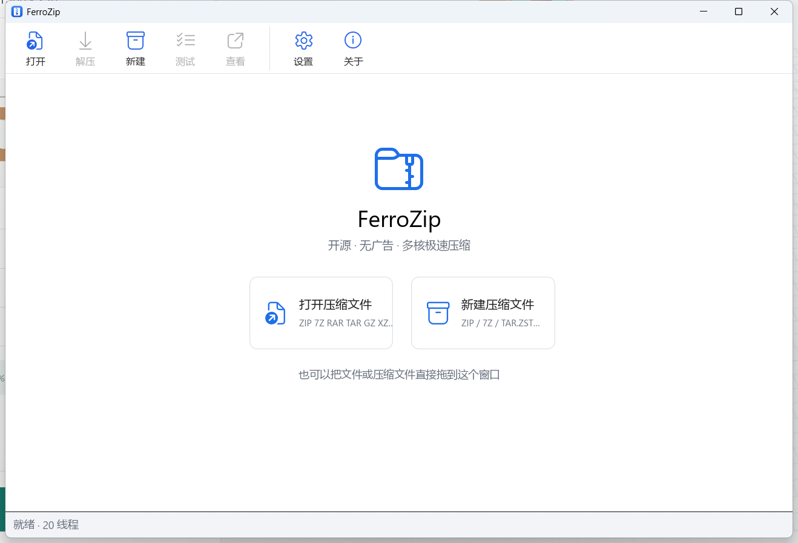
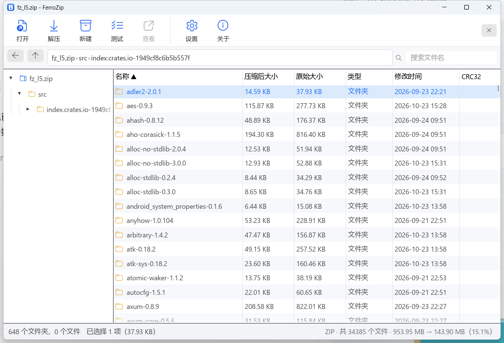
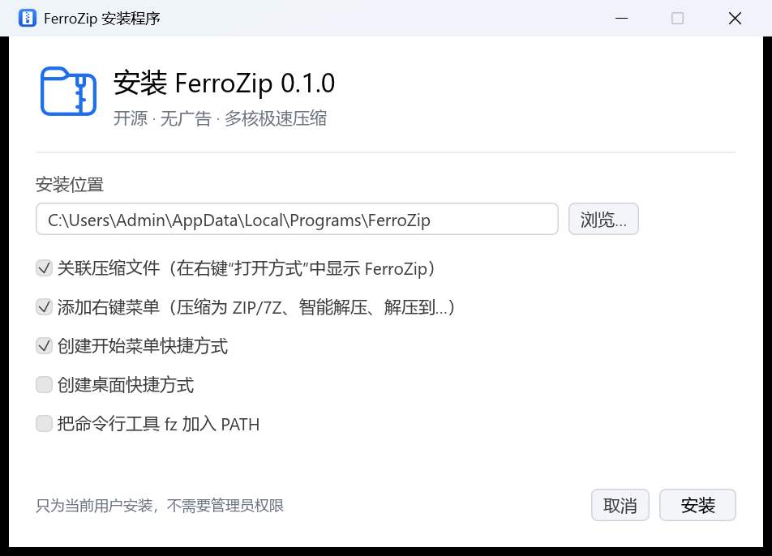

# FerroZip

开源、无广告、为多核 CPU 设计的 Windows 压缩软件。界面与使用习惯参考 Bandizip，引擎用 Rust 从头组织，把能并行的地方都并行了。

当前为 **0.1.0 早期版本**，主要面向 Windows x64。FerroZip 是独立项目，与 Bandisoft / Bandizip 无隶属关系。




## 为什么做它

先调研了目前最流行的开源压缩软件（GitHub 数据，2026-10-23）：

| 项目 | Star | 语言 | 许可证 | 说明 |
|---|---:|---|---|---|
| [NanaZip](https://github.com/M2Team/NanaZip) | 16.0k | C++ | MIT（基于 7-Zip） | 7-Zip 分支，Win11 新式右键菜单，界面现代 |
| [PeaZip](https://github.com/peazip/PeaZip) | 8.0k | Pascal | LGPL-3.0 | 支持格式最多，跨平台 |
| [Keka](https://github.com/aonez/Keka) | 7.5k | — | — | macOS |
| [7-Zip-zstd](https://github.com/mcmilk/7-Zip-zstd) | 7.5k | C++ | LGPL | 7-Zip + Zstd/Brotli/LZ4 |
| [7-Zip](https://github.com/ip7z/7zip) | 4.2k（主仓库在 SourceForge，下载量最大） | C++ | LGPL + unRAR | 事实标准 |
| [ouch](https://github.com/ouch-org/ouch) | 3.8k | Rust | MIT | 命令行 |
| [libarchive](https://github.com/libarchive/libarchive) | 3.6k | C | BSD | 库（Windows 自带 tar.exe 用的就是它） |

它们要么界面老旧（7-Zip），要么压缩 ZIP 时单个文件只能用一个核心。Bandizip 体验好但闭源、免费版有广告。FerroZip 的目标是：**Bandizip 的易用性 + 开源 + 无广告 + 把所有核心跑满**。

## 性能

测试数据：Cargo 源码缓存，1.14 GB / 44,989 个文件（源码为主），另有一个 1.19 GB 的单文件（同一批数据打成的 tar）。CPU：Intel Core Ultra 7 265KF（8P+12E，20 线程）；NVMe SSD，Windows Defender 实时保护开启。对比对象 Bandizip 7.43，同级别对比，压缩取两次中较快的一次，大小单位 MiB。

| 测试 | FerroZip | Bandizip 7.43 | 结果 |
|---|---:|---:|---|
| 压缩 ZIP 级别 1 | **0.88 秒** / 192.5 | 7.84 秒 / 205.4 | 快 8.9 倍，更小 |
| 压缩 ZIP 级别 5（标准） | **1.07 秒** / 172.1 | 10.58 秒 / 176.4 | 快 **9.9 倍**，更小 |
| 压缩 ZIP 级别 9 | **19.7 秒** / 164.3 | 23.2 秒 / 170.2 | 更快，小 3.5% |
| 压缩 7Z 级别 1 | **2.70 秒** / 101.0 | 5.82 秒 / 114.8 | 快 2.2 倍，小 12% |
| 压缩 7Z 级别 5（标准） | **12.9 秒** / 75.0 | 21.8 秒 / 76.8 | 快 1.7 倍，更小 |
| 压缩 7Z 级别 9 | **31.9 秒** / 63.3 | 46.8 秒 / 64.1 | 快 1.5 倍，更小 |
| 压缩 7Z 级别 5，1.19 GB 单文件 | **16.8 秒** / 80.1 | 20.9 秒 / 79.9 | 快 24%，大小持平 |
| 测试 ZIP（只解码不写盘） | **0.39 秒** | 0.44 秒 | 约 2.9 GB/s |
| 测试 7Z（FerroZip 创建 / Bandizip 创建） | **0.51 / 0.71 秒** | 2.32 / 0.72 秒 | |
| 解压 ZIP（FerroZip 创建 / Bandizip 创建） | **17.4 / 16.4 秒** | 23.3 / 19.6 秒 | 快 16%–25% |
| 解压 7Z（FerroZip 创建 / Bandizip 创建） | **16.8 / 16.8 秒** | 20.5 / 22.3 秒 | 快 18%–25% |
| 压缩 TAR.GZ / TAR.ZST | 1.2 秒 / 1.2 秒 | — | |

解压慢在系统而不在解码：见下文“解压为什么到不了纯解码的速度”。

## 功能

- **格式**：创建 ZIP、7Z、TAR、TAR.GZ、TAR.ZST、TAR.XZ、TAR.BZ2；打开/解压以上全部，外加 RAR（含 RAR5）、GZ/ZST/XZ/BZ2 单文件、自解压 ZIP
- **加密**：ZIP 用 AES-256（WinZip AE-2，Bandizip、7-Zip、WinRAR 都能解）；7Z 用 AES-256，可加密文件名
- **类 Bandizip 界面**：工具栏、地址栏面包屑、文件夹树、可排序多选列表、搜索、状态栏；双击文件直接用默认程序打开
- **智能解压**：压缩包里只有一个顶层文件夹时直接解压到旁边，否则新建同名文件夹
- **右键菜单**（设置里一键添加，只写 HKCU，无需管理员）：压缩为 ZIP/7Z、压缩到…、智能解压、解压到当前文件夹、解压到…；在资源管理器里多选会合并成一个任务
- **中文文件名**：没有 UTF-8 标记的旧 ZIP 自动按系统代码页（GBK 等）解码，也可以手动选编码
- 拖放：拖入压缩文件就打开，拖入普通文件就新建压缩文件
- 覆盖 / 跳过 / 自动重命名；可取消；显示速度和剩余时间
- 防路径穿越（`../`、盘符、保留名都会被清理）
- 单个 exe，不依赖 VC++ 运行库

## 为什么快

| 环节 | 做法 |
|---|---|
| Deflate | 内置 libdeflate（比 zlib 同级别快约 40%、压缩率还略好；解压快 2.9 倍）。给它加了一个小补丁 `libdeflate_deflate_compress_chunk()`：分块输出不带 BFINAL、以字节对齐的空存储块结尾，于是**多个线程分别压缩的块可以直接拼成一条 Deflate 流**（pigz 的原理），单个大文件也能用满所有核心 |
| ZIP 压缩 | 自研 ZIP 写入器：小文件整文件并行压缩，大文件 1 MB 一块并行压缩，按块算 CRC32 再合并；目录扫描用 `FindFirstFileExW` 批量读取、所有文件夹并行列出（4.5 万文件 70 ms） |
| ZIP 解压 | 压缩包映射进内存，各线程直接从映射里取压缩数据，libdeflate 一次解压到缓冲区、校验 CRC、一次写出（零拷贝、无流式开销）；按压缩包顺序分配，减少不同文件夹间的争用 |
| 7Z 压缩 | 自研 7z 写入器：LZMA2 用 C 版 liblzma（比纯 Rust 实现快约 26%）；按扩展名 + 文件名排序（与 7-Zip 相同，同名的 LICENSE/Cargo.toml 会落在同一个字典窗口里）；固实块并行压缩、**按完成顺序写出**，块大小随剩余工作量递减，快慢核心同时收尾；大文件切片并行 LZMA2，在字典重置点拼接（7-Zip 多线程 LZMA2 的同款格式）；AES-256 与 7-Zip 完全兼容 |
| 已压缩文件 | JPG、MP4、ZIP 等直接存储（7Z 里放进 Copy 块），压缩后反而变大的文件自动改为存储 |
| TAR.* | 工作线程预读文件；gzip 按块并行（libdeflate），bzip2 按块并行（lbzip2 方式），zstd 和 xz 用各自的多线程编码器 |
| 7Z/TAR 解压 | 7Z 的多个块并行解码；固实流解码在一个线程，写文件交给写入线程池 |
| 线程池 | `OrderedPool`：有序或按完成顺序输出，限制在途任务数，内存有上限 |

### 解压为什么到不了“纯解码”的速度

微基准（`examples/fsbench.rs`，按原样重放 4.5 万个文件）显示：在开着 Windows Defender 实时保护的机器上，**每写一个文件，Defender 要花约 5 ms CPU 扫描它**——4.5 万个文件合计约 245 CPU 秒，十几个核心被它占满。所以不管 1 个线程还是 64 个线程、用什么写法，写出这些文件都要约 15 秒；只建空文件则只要 3 秒。FerroZip 的解压已经贴着这个下限（多出来的部分在 1–2 秒内），纯解码只要 0.4 秒。

想再快只能从系统层面解决：把解压目标放在 Windows 11 的 **Dev Drive**（ReFS，Defender 异步扫描），或者自己评估风险后把目标文件夹加入 Defender 排除项。FerroZip 不会、也不应该替你绕过杀毒扫描。

## 安装

运行 `FerroZip-Setup-<版本>.exe`（由 `package.ps1` 生成在 `dist\`）。只为当前用户安装到 `%LOCALAPPDATA%\Programs\FerroZip`，**不需要管理员权限**。

GitHub 的 Actions 页面中，成功的 `Windows build and test` 运行会提供 `FerroZip-Windows-x64` 构建产物，下载并解压后即可获得安装程序。



安装后：

- 在压缩文件上**右键 → 打开方式 → FerroZip**（zip/7z/rar/tar/gz/zst/xz/bz2 等 14 种扩展名）
- “显示更多选项”里有 FerroZip 菜单：压缩为 ZIP/7Z、压缩到…、智能解压、解压到当前文件夹、解压到…
- 想让双击直接用 FerroZip：安装完成页点“设为默认压缩软件”，或在“打开方式 → 选择其他应用”里勾选“始终”（Windows 不允许程序自己抢默认程序）
- 开始菜单快捷方式；可选桌面快捷方式、把 `fz` 加入 PATH
- “设置 → 应用 → 已安装的应用”里可以卸载；再次运行安装程序可以更新（FerroZip 开着也能更新）
- 静默安装 / 卸载：`FerroZip-Setup.exe --quiet`、`uninstall.exe --uninstall --quiet`

所有注册都写在 `HKCU`，卸载时全部清除，只保留 `%APPDATA%\FerroZip` 里的设置。Windows 11 一级右键菜单（不点“显示更多选项”就出现的那种）需要带签名的 MSIX 包和 COM 扩展，暂未实现。

## 构建

需要 Rust（MSVC 工具链）和 Visual Studio Build Tools（编译 libdeflate、zstd、liblzma、unRAR 的 C/C++ 代码）。libdeflate 1.26 的源码连同补丁一起放在 `crates/fz-core/vendor/libdeflate`。

```bash
cargo build --release --locked
```

产物：

- `target/release/FerroZip.exe` — 图形界面
- `target/release/fz.exe` — 命令行
- 安装程序：`powershell -ExecutionPolicy Bypass -File package.ps1` → `dist\FerroZip-Setup-<版本>.exe`（内嵌上面两个程序，zstd 压缩）

不含 RAR 的纯 OSI 许可证版本：`cargo build --release --no-default-features`。

## 命令行

```
fz a [-l 0-9] [-t 线程] [-p 密码] [-m zstd] 输出.zip 文件或文件夹...
fz x [-o 目录] [-p 密码] [-y|-s|-r] 压缩文件     # 不带 -o 时智能解压
fz l 压缩文件
fz t 压缩文件
```

格式由扩展名决定：`.zip .7z .tar .tar.gz .tar.zst .tar.xz .tar.bz2`。

## 代码结构

```
crates/
  fz-core/   引擎：deflate（libdeflate 封装）、zipwrite（ZIP 写入 + AES）、sevenz_write（7z 写入 + 7zAES）、
             pstream（并行 deflate/bzip2）、pool（线程池）、scan（并行目录扫描）、
             create / extract / read、sevenz（7z 读取）、tarfmt、zipread、rar、codepage
             examples/：fsbench（文件创建/Defender 微基准）、deflatebench（压缩库对比）、sz7info（查看 7z 块结构）
  fz-cli/    fz 命令行
  fz-gui/    FerroZip 图形界面（egui）：app、tree、task、collect（多选合并）
  fz-shell/  Windows 集成：打开方式关联、右键菜单、默认应用登记、卸载信息、PATH、快捷方式
  fz-setup/  安装 / 卸载程序（FerroZip-Setup.exe，复制到安装目录后作为 uninstall.exe）
```

测试：`cargo test --workspace`。覆盖各格式往返、AES、密码错误、部分解压、路径清理、编码、分块 Deflate 拼接、7z 大文件分片 + AES 等。FerroZip 生成的 ZIP、AES-ZIP、Zstd-ZIP、7Z（多块、Copy 块、空文件夹混排、AES 中文密码、加密文件名、分片大文件）、TAR.GZ、TAR.XZ 都用 Bandizip 的 `bz t` 交叉验证过。

设置环境变量 `FZ_TRACE=1` 可以打印各阶段耗时。fz-shell 中会写注册表的测试默认跳过，它们只写 `HKCU\Software\FerroZipTest` 沙盒键，需要时用 `cargo test -p fz-shell -- --ignored` 运行。

## 已知限制 / 计划

- 还不能向已有压缩文件里添加或删除文件（目前只能新建）
- 不支持分卷压缩，也不能从窗口拖出文件到资源管理器
- Windows 11 的新式右键菜单需要 IExplorerCommand 和打包签名，目前菜单在“显示更多选项”里
- liblzma 没有 7-Zip 那样的多线程匹配查找器，所以 7Z 的提速靠更多、更合理的并行块，而不是单个编码器更快
- 早期版本用 sevenz-rust2 写 7z 时发现它的一个 bug：空文件夹/空文件混排时 kEmptyFile 位图长度写错，7-Zip/Bandizip 会报“文件损坏”。现在写入用的是自研写入器，不受影响，但这个 bug 仍值得提交给上游

## 许可证

MIT。内置的 libdeflate 为 MIT 许可（见 `crates/fz-core/vendor/libdeflate/COPYING`）。RAR 解压部分使用 unRAR 源码（允许免费使用和分发，但禁止用来重建 RAR 压缩算法），详见 [LICENSE](LICENSE)。
